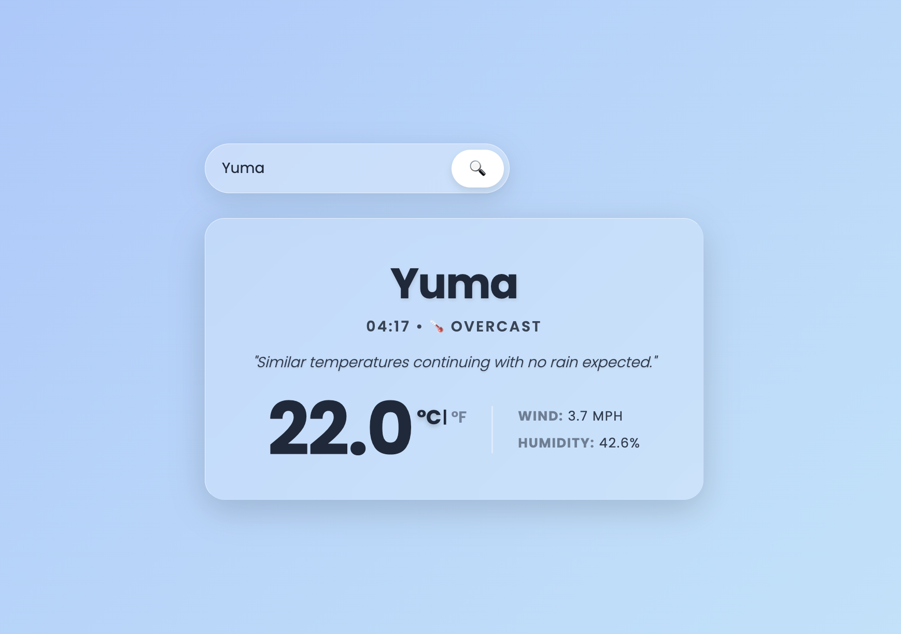

# 🌤️ Weather App

A dynamic weather forecast application built using **JavaScript, HTML, and CSS**.  
The application interacts with an external API to handle asynchronous data fetching, error handling, and dynamic DOM manipulation to display real-time weather conditions.

The project focuses on **Promises, async/await, API integration, and dynamic CSS styling**.

## Live Demo

[View on GitHub Pages](https://inaladevi.github.io/weather-app/)

## Features

- **Asynchronous API Integration** using `fetch` and `async/await` to securely retrieve real-time data from the Visual Crossing Weather API.
- **Dynamic DOM Rendering** to instantly update the UI with specific data points: temperature, conditions, wind speed, humidity, descriptions, and time.
- **Dynamic Theming** where the application's background gradient seamlessly transitions to match the searched city's current weather conditions (e.g., sunny, rainy, stormy, cloudy).
- **Unit Conversion Toggle** allowing users to instantly switch between Celsius and Fahrenheit. The math is handled purely on the frontend, avoiding unnecessary API calls.
- **Robust Error Handling** using `try/catch` blocks to display user-friendly UI messages for invalid city searches or failed network requests.
- **Premium UI/UX** utilizing CSS Flexbox, interactive hover states, and a modern "Glassmorphism" design system (using `backdrop-filter`).
- **Auto-Load Functionality** that automatically fetches and displays a default city ("Yuma") when the application first loads to prevent an empty state.

## Built With

- **HTML5**
- **CSS3**
  - Flexbox Layouts
  - Glassmorphism (`backdrop-filter`, `rgba`)
  - Linear Gradients & Transitions
- **JavaScript (ES6+)**
  - Asynchronous functions (`async / await`)
  - DOM Manipulation
  - Event Listeners & State Management
- **APIs**
  - Visual Crossing Weather API

## Preview

